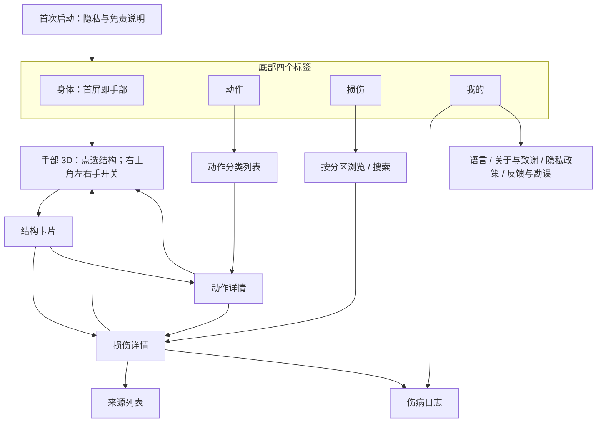

# App 页面结构与交互规范

状态：2026-11-22 负责人确认了首屏、左右手和日志字段（决策 0010），其余仍为初稿。这里只定"有哪些页面、怎么走、每页必须有什么"，不定视觉。视觉方向见 `mockups/`。

## 设计原则

1. **受伤的人最先被服务。** "我这里不舒服"的路径不超过三次点击到达相关内容。
2. **3D 是手段。** 任何通过 3D 能到达的内容，都能通过列表到达（准则 6.9）。
3. **危险信号永远最显眼。** 损伤页中"出现这些情况请尽快就医"排在一般原则之前，视觉权重最高。
4. **不替用户下判断。** 页面只呈现"文献里怎么说"，不出现"你可能是……"这类针对个人的结论。

## 页面地图

## 四个标签

| 标签 | 回答的问题 | 首屏 |
|---|---|---|
| 身体 | 这里是什么？哪里容易出问题？ | 直接显示手部模型（默认左手），右上角左右手开关 |
| 动作 | 这个动作在用哪里、伤哪里？ | 五个分类：抓握方式、身体姿态、动态动作、坠落与落地、专项训练 |
| 损伤 | 这种伤是怎么回事？ | 按分区分组的损伤列表，顶部搜索 |
| 我的 | 我的记录和设置 | 伤病日志入口、语言、关于 |

## 三层下钻（身体标签）

| 层级 | 画面 | 点一下的结果 | 返回方式 |
|---|---|---|---|
| 0 手 | 整只手，前臂露出一部分 | 点任一结构：镜头推近到它所在的分区（如环指），其余变暗，同时选中该结构 | 无 |
| 1 分区 | 例如环指 | 点同一分区内的其他结构：直接切换选中 | 面包屑"左手"或"右手" |
| 2 结构 | 结构高亮，底部卡片显示名称 | 卡片内链接到相关损伤和动作（有已审阅条目时） | 面包屑中的分区名、卡片的关闭按钮 |

点画面空白处只取消选中，不改变镜头。

- 面包屑始终显示当前位置，例如"左手 › 环指 › 环指 A2 滑车"。
- 图层开关（骨骼、肌肉与肌腱、筋膜、滑车、韧带）在所有层级可用。被遮挡的深层结构靠关闭浅层图层来查看。
- 手势：单指旋转，双指缩放与平移，单击选择。不使用长按和双击，避免误触。
- 每一层都有"列表"按钮，列出当前范围内的全部结构，按图层分组；点一项即在 3D 中选中它（被隐藏的图层会自动打开）。
- 左右手开关在右上角。左手是右手模型的镜像（决策 0010）。

## 结构卡片必须包含

中文名；英文名与拉丁名；一句话功能；出现率（若有文献数据）；相关损伤；相关动作；"在列表中查看"。

## 损伤详情必须包含（顺序固定）

1. 名称与状态徽标（草稿不会出现在 App 中；显示"已对照来源"或"专业人士已审阅"及日期）
2. 概述
3. 怎么发生的
4. 文献中常见的表现
5. **出现这些情况请尽快就医**
6. 一般原则
7. 分级与参考时间（如该损伤有公认分级；每档写范围并注明个体差异）
8. 预防
9. 证据的不确定之处
10. 来源（编号，可点开）
11. 免责声明（固定显示）

操作：在 3D 中查看；记到我的日志；报告错误。

## 动作详情必须包含

名称与别名；一句话说明；"发力结构"与"易伤部位"两个分页；每个结构标注角色（主动肌、协同肌、稳定肌、受力的非收缩结构）；关联损伤附一句定性说明；在 3D 中查看。

## 伤病日志（第一版）

字段：日期、部位（从结构或分区选择）、关联的损伤条目（可选）、当时在做的动作（可选）、不适程度（0–10 自评）、备注、当前状态（进行中或已恢复）。

- 首次使用前单独说明"数据只保存在本机"并征得同意。
- 第三条记录后提醒一次备份。
- 设置里提供导出、导入、全部删除。
- 日志不做任何解读或建议，只是记录。

## 首次启动

一屏说明：这是运动科普，不能替代医生面诊；不收集个人信息；日志只存本机。同意后进入。隐私政策与用户协议可随时在"我的"里查看。

## 明确不做（第一版）

- 输入症状得出判断的功能，包括 AI 形式
- 用户发布内容、评论、社群
- 账号与登录
- 受伤故事库（需要当事人书面授权，流程未建立）

## 已决问题（决策 0010）

1. 首屏：进"身体"，直接显示手部模型。
2. 默认左手，右上角开关切换。
3. 日志保留"不适程度"。

## 待决问题

1. 肩部建模后从首屏如何到达肩部。建议在面包屑根节点上做分区切换。
2. 横屏是否支持。建议手机锁定竖屏。
